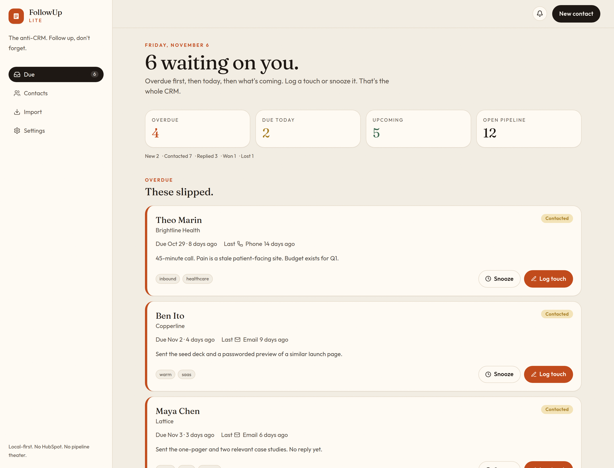
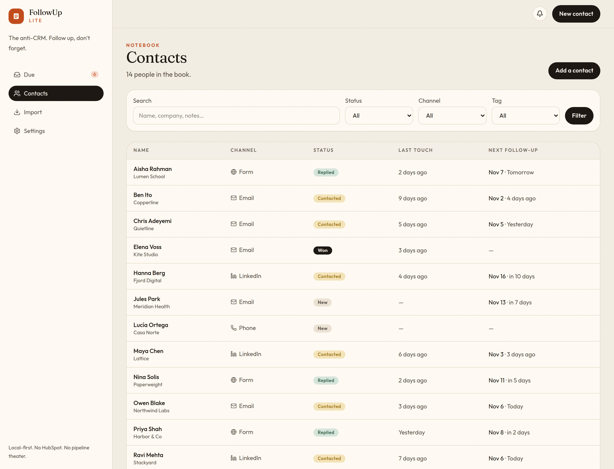
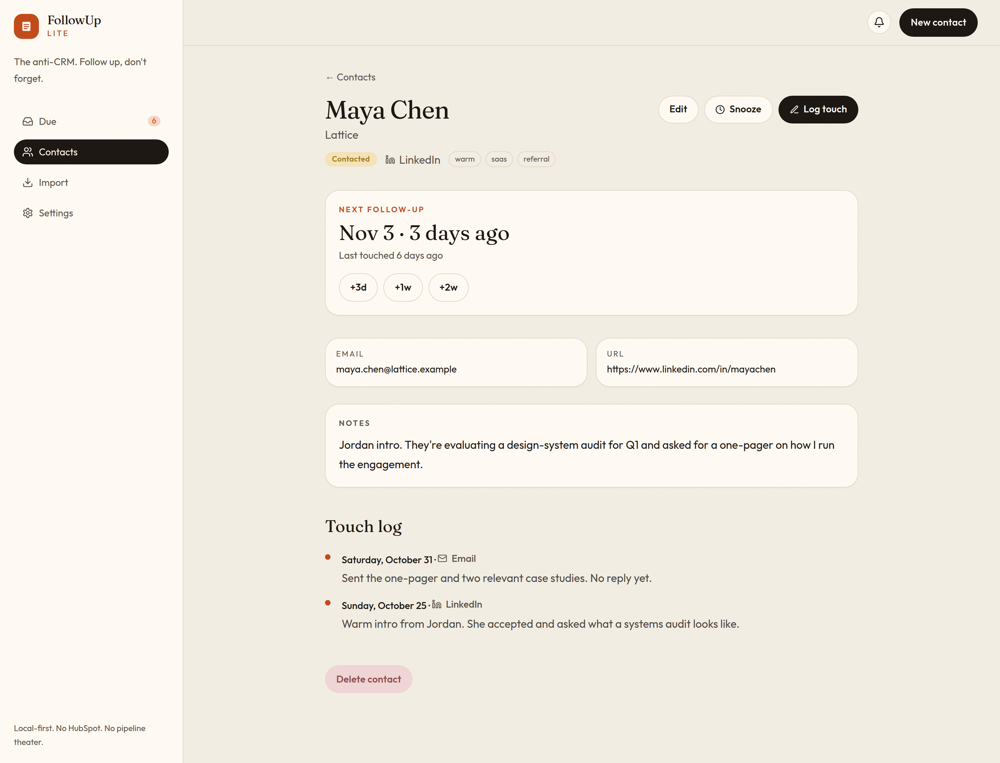
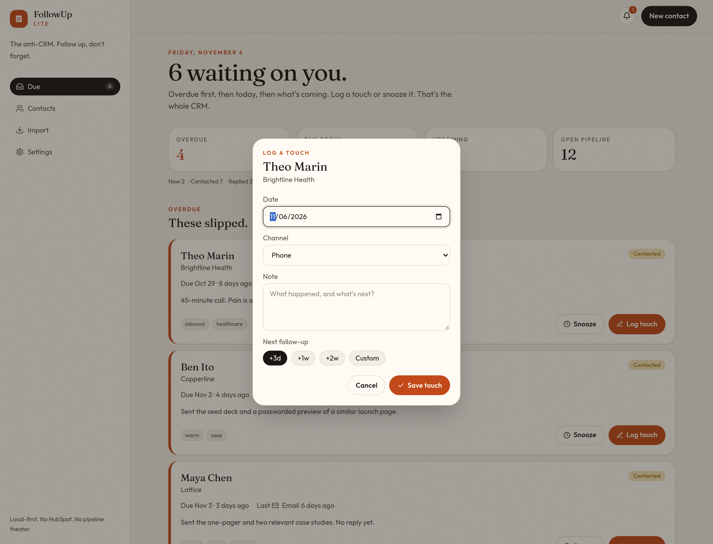
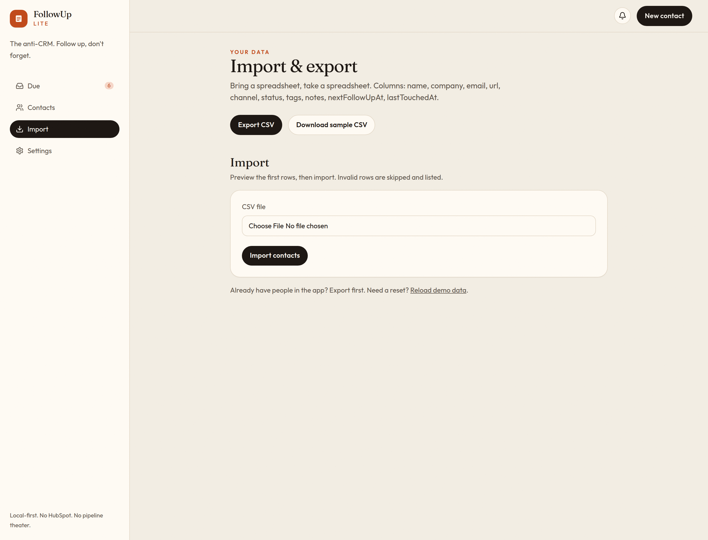
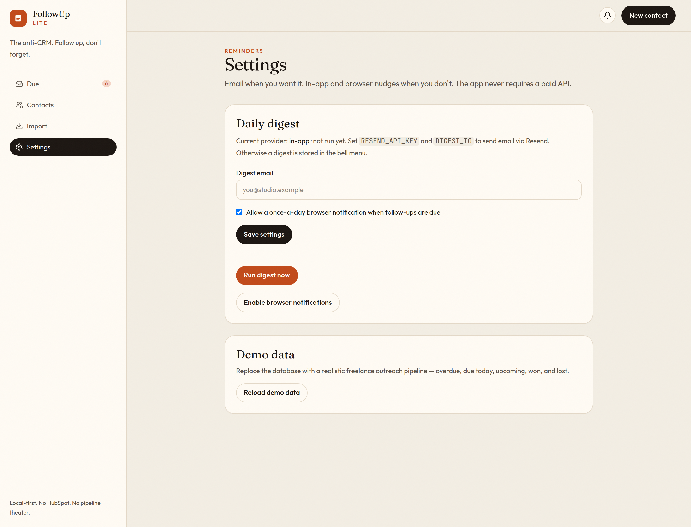

# FollowUp Lite

**The anti-CRM.** Log who you contacted, on which channel, when — and get nudged when a follow-up is due. Built for freelancers, solo founders, and small-agency business development who do not need HubSpot.

Freelancers already know who they should ping. The painful part is remembering *when*. That gap showed up again and again in [this r/SaaS thread](https://www.reddit.com/r/SaaS/comments/1ltk7i7/freelancers_solo_business_owners_whats_that_one/): outreach lives in a graveyard of starred emails, LinkedIn tabs, and “I’ll follow up next week” notes that never fire. FollowUp Lite is a notebook with a due date, not a pipeline with 47 unused objects.



## Features

- **Contacts** — name, company, email/URL, channel (Email, LinkedIn, Form, Phone, Other), status (New, Contacted, Replied, Won, Lost), tags, and notes.
- **Touch log** — every outreach has a date, channel, and note. The last touch is always visible. Next follow-up uses quick presets: **+3d**, **+1w**, **+2w**.
- **Due-today queue** — overdue, due today, and upcoming, with one-click **Log touch** and **Snooze** (+1d / +3d / +1w / +2w). Won and lost deals stay out of the queue.
- **Search & filter** — by name/company/notes, status, channel, and tag.
- **CSV import & export** — including a sample file. No lock-in.
- **Daily digest** — email via a pluggable Resend provider when `RESEND_API_KEY` and a recipient are set. Otherwise the digest lands in the in-app bell and (optionally) a once-a-day browser notification. The app runs fully with **no paid services or API keys**.
- **Optional password gate** — set `AUTH_PASSWORD` if you want one. Leave it unset for a frictionless demo.











## Tech stack

- **Next.js 16** (App Router) + **React 19** + **TypeScript**
- **Tailwind CSS v4**
- **Prisma** + **SQLite** (local file, zero hosted database)
- **Vitest** for follow-up, due-date, CSV, and digest logic
- **GitHub Actions** for lint, test, and build

No SaaS SDKs are required at runtime. Resend is an optional HTTP call behind an env flag.

## Setup

You need Node.js 22+.

```bash
cp .env.example .env
npm install
npm run setup    # prisma generate + SQLite database + demo data
npm run dev      # http://localhost:3000
```

`npm run setup` seeds a realistic freelance outreach book so the dashboard is not empty on first run. Reload it anytime from **Settings → Reload demo data**.

Production-style run:

```bash
npm run build
npm start
```

### Optional email digest

In `.env`:

```bash
RESEND_API_KEY="re_xxxxxxxxx"
DIGEST_TO="you@example.com"
# DIGEST_FROM="FollowUp Lite <onboarding@resend.dev>"
```

Trigger a digest from **Settings → Run digest now**, or from cron:

```bash
curl -X POST http://localhost:3000/api/digest
# If CRON_SECRET is set:
curl -X POST http://localhost:3000/api/digest \
  -H "Authorization: Bearer $CRON_SECRET"
```

Without those env vars, the same endpoint writes an in-app reminder. Enable browser notifications on the settings page for a local daily nudge.

### Optional basic auth

```bash
AUTH_PASSWORD="change-me"
AUTH_SECRET="a-long-random-string"
```

## Tests & CI

```bash
npm test        # due dates, snooze, CSV, digest provider selection
npm run lint
npm run build
```

GitHub Actions runs lint, test, and build on every push and pull request.

## Roadmap

- Shared books for a two-person studio, still without CRM bloat
- Calendar ICS export for the due queue
- LinkedIn / Gmail “logged it” bookmarklet
- Snooze-until-a-named-day (“next Tuesday”)
- Mobile-first PWA install so the queue lives on the home screen

## License

MIT. See [LICENSE](LICENSE).
